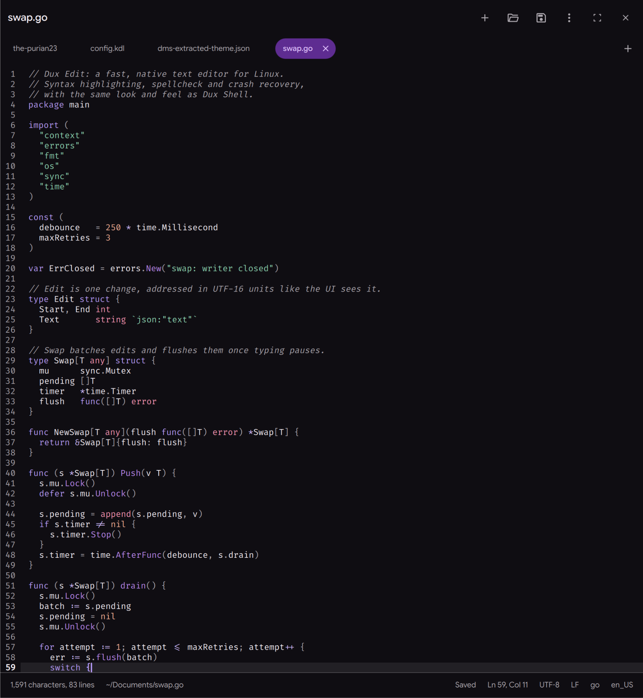

# Dux Edit

<div align="center">
  <a href="https://duxlabs.dev">
    
  </a>

### A text and document editor for the dux desktop

Built with [dux-qt-base](https://github.com/duxlabs-dev/dux-qt-base) and [Go](https://go.dev/)

[](https://github.com/duxlabs-dev/dux-edit/blob/master/LICENSE)
[](https://discord.gg/ppWTpKmPgT)
[](https://ko-fi.com/duxlabs)



</div>

Dux Edit opens any text file without a project around it: notes, config files, scripts, Markdown. It sits between a scratchpad and an IDE, and takes over from the DMS notepad.

- Tabs, drafts that survive a restart, and crash recovery
- Syntax highlighting with [Chroma](https://github.com/alecthomas/chroma), colored from the desktop theme
- Markdown preview, spellcheck, find and replace with regular expressions
- Keeps encodings and line endings as they are, and saves root-owned files through polkit
- Simple and Advanced modes

Dux Edit is a Go binary that carries its own QML UI and runs it on [dux-qt-base](https://github.com/duxlabs-dev/dux-qt-base).

## Installation

Dux Edit is packaged as `dux-edit` (stable) and `dux-edit-git` (development) for Arch (AUR, `dux-edit-bin`), Fedora and CentOS (Copr), Debian and openSUSE (OBS), Ubuntu (PPA) and Void (stable only). Add the [Dux Labs repository](https://duxlabs.dev/docs/repo/) for your distribution and install it:

```sh
paru -S dux-edit-bin             # Arch
sudo dnf install dux-edit        # Fedora, after enabling the duxlabs/dux-repo Copr
sudo apt install dux-edit        # Debian and Ubuntu
sudo zypper install dux-edit     # openSUSE
sudo xbps-install -S dux-edit    # Void
```

Release binaries, building from source and making it your default editor are covered in the [installation guide](https://duxlabs.dev/docs/dedit/installation).

## Using it

```sh
dux-edit                          # show the window, start the app first if it is not running
dux-edit notes.md todo.txt        # open files as tabs in the running app
dux-edit main.go --line 42 --column 7
```

CLI commands, settings, keyboard shortcuts, plugins and the IPC surface are in the [Dux Edit documentation](https://duxlabs.dev/docs/dedit/).

## Development

You need Go and dux-qt-base 0.4.3 or newer.

```sh
git clone --recurse-submodules https://github.com/duxlabs-dev/dux-edit.git
cd dux-edit
make run
```

`make run` makes a build without the embedded UI and loads `quickshell/` straight from the repo, with hot reload.

## License

MIT
